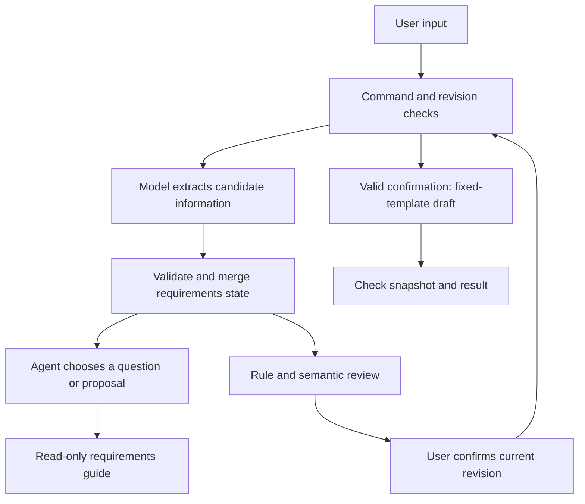

# Dify Senior PM Agent

[简体中文](README.md) | [English](README.en.md)

**A product manager interview Agent that clarifies requirements through multiple turns, reviews and confirms the current revision, and produces a ten-chapter Markdown PRD.**

This Dify Chatflow turns a product idea into a reviewed PRD through guided interviews, structured state, and explicit revision confirmation.

It is an independent product manager assistant prototype for learning requirements interviews, the division of responsibility between an Agent and a workflow, and how to turn prompts into an inspectable product process. Users can discuss product concepts and methods or start organizing requirements from an initial idea.

**Status: public prototype.** The local rules and build have been checked. After importing the project into a new Dify workspace, select available models, rebind the two workflow tools, and validate the flow in Preview. The current output is Markdown; Word file downloads are not implemented.

The documentation is available in full Chinese and English editions. The exported conversation prompts, commands, and PRD templates currently use primarily Chinese. English prompt references and example translations support study and comparison; English conversations have not been validated with live models.

## The problem it addresses

Asking a model to “write a PRD” can skip requirements clarification, present suggestions as facts, or reuse an outdated draft after requirements change. This project manages recorded requirements, proposals, review findings, and revision confirmation separately so users can inspect, revise, and confirm the requirements as they develop.

Models extract candidate information, choose follow-up questions, and perform semantic review. Python rules handle structure, references, revisions, state merging, and fixed-template rendering. Users still need to review semantic interpretation; see the [validation record](docs/VALIDATION.en.md) for the limits.

## Core capabilities

| Capability | Current implementation |
| --- | --- |
| Product-method questions | Explain concepts such as MVP without requiring every requirements field to be completed first |
| Multi-turn requirements interviews | Work through 21 fields, extract several fields from one answer, and allow progress checks, edits, and skips |
| Proposal management | Keep candidate suggestions separate from recorded requirements; accept or reject proposals by ID |
| Requirements relationships | Maintain stable IDs for goals, personas, stories, features, and metrics; check references and coverage |
| Review and confirmation | Provide a ten-chapter summary, gaps, and review findings; confirm the current content revision |
| Deterministic drafting | Generate a ten-chapter Markdown PRD and Review Notes from a frozen snapshot |
| Failure handling | Preserve the previous requirements state when model output is invalid, a merge fails, or the rendered result is inconsistent |

## Workflow



The main flow contains 19 nodes. Two helper workflows contain 3 nodes each. The interview Agent can only use the read-only requirements guide; the rendering tool is called by the main workflow's confirmation branch. See the [architecture guide](docs/ARCHITECTURE.en.md) for the full division of responsibility.

## Quick start

1. Download this repository and open your own Dify workspace.
2. Import [get_slot_guide.yml](dify/get_slot_guide.yml), publish it as a workflow tool, and set its callable name to `get_slot_guide`.
3. Import [render_prd.yml](dify/render_prd.yml), publish it as a workflow tool, and set its callable name to `render_prd`.
4. Import [pm_qa_agent.yml](dify/pm_qa_agent.yml). Select your requirements-guide tool again in `N08` and your rendering tool again in `N16`.
5. Select models available in your workspace in `N04`, `N08`, and `N11`, and configure the model provider credentials.
6. Use the [synthetic example](examples/README.en.md) in Preview, check review and revision confirmation, and then publish your own application.

**These three YAML files are Dify DSL exports.** The public copies replace the two original workspace tool IDs with `REPLACE_WITH_…` markers. Rebinding is required before running the flow. Model fields retain the original `deepseek-flash` identifier; this does not guarantee its availability in another workspace. See the [setup guide](docs/GETTING_STARTED.en.md) for detailed configuration and troubleshooting. Keep the Chinese command literals documented there when interacting with the current runtime.

## Local validation and build

Use Python 3.10 or newer. The rule runtime uses only the Python standard library; the DSL builder requires PyYAML.

```bash
python -m pip install -r requirements.txt
python -m unittest discover -s tests -v
python src/build_dsl.py
python scripts/make_example.py
```

Build output is written to `dist/` and retains the public tool placeholders, which must be rebound in the target Dify workspace. `dify/` contains the cleaned copies of the previously published configuration; the builder may produce a different canvas layout. Tests do not call paid models or external services.

## Repository guide

| Path | Purpose |
| --- | --- |
| `dify/` | Public DSL exports of the main Chatflow and two helper workflows |
| `src/runtime.py` | Requirements state, merging, review, confirmation, and rendering rules |
| `src/registry.json` | The 21 requirements fields and their completion criteria |
| `src/interviewer.md` | Current operational interview-Agent prompt |
| `src/build_dsl.py`, `src/templates/` | DSL builder and cleaned node templates |
| [prompts/](prompts/README.md), `schemas/` | Chinese and English prompt references, plus extraction, interview, review, and output-structure references |
| `tests/` | 31 programmatic regression checks and a synthetic provider-format compatibility fixture |
| [examples/](examples/README.en.md) | Synthetic requirements input, a reproducible snapshot and PRD output, and English reading translations |
| `docs/` | Setup, architecture, validation, and known limits; each guide has Chinese and English editions |

## Validation scope and limits

On 2026-10-08, all **31 existing local Python regression checks passed**, covering state merging, evidence matching, entity references, proposals, skipping, revision confirmation, snapshots, and rendering. The public copies were also checked for YAML parsing, workflow connectivity, and embedded Python syntax. Preparing this publication did not rerun live models or validate import into a new Dify workspace.

The current project does not include web search, knowledge-base retrieval, attachment parsing, Word downloads, or an independent website backend. Semantic errors, misread negation, and ambiguous acceptance can still occur; structural validation does not guarantee professional PRD quality. A draft with disclosed risks can be generated when the user explicitly accepts the outstanding items. See [validation and known limits](docs/VALIDATION.en.md).

## Sources and licensing

The requirements-interview mechanism draws on [wwwazzz/senior-pm-prompt](https://github.com/wwwazzz/senior-pm-prompt). This project adds Dify orchestration, structured state, programmatic merging and confirmation, tool separation, and regression checks.

See [THIRD_PARTY_NOTICES.md](THIRD_PARTY_NOTICES.md), available in both languages, for the upstream permission statement and the licensing status of this project's additions. No standard open-source license has been assigned to the new content in this publication.

## Privacy

The public repository uses synthetic test content and excludes the original runtime logs, original workspace tool bindings, and original live application entry point. Do not commit model credentials, private conversations, personal contact details, or exports containing secret values. See the bilingual [SECURITY.md](SECURITY.md).
