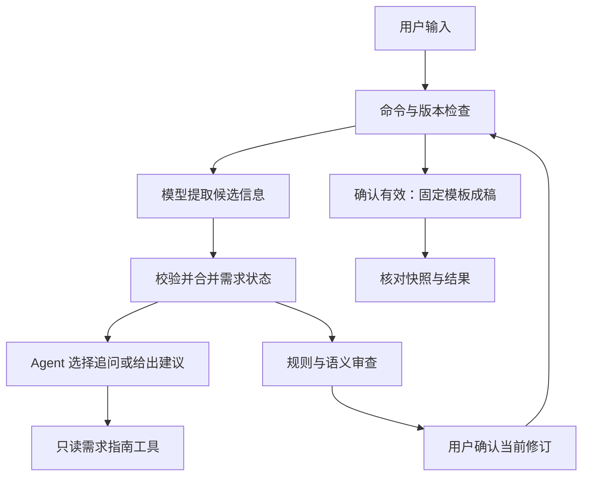

# Dify Senior PM Agent

**产品经理问答 Agent：通过多轮访谈澄清需求，经审查与版本确认，生成十章 Markdown PRD。**

A Dify Chatflow that turns a product idea into a reviewed PRD through guided interviews, structured state, and explicit revision confirmation.

这是一个独立的产品经理助手原型，适合学习需求访谈、Agent 与工作流的分工，以及如何把提示词转成可检查的产品流程。既可以讨论产品概念与方法，也可以从一个想法开始整理需求。

**状态：公开原型 / Prototype。** 已验证本地规则与构建；导入新的 Dify 工作区后，需要选择可用模型、重新绑定两个工作流工具并完成预览验证。当前输出为 Markdown，尚未接入 Word 文件下载。

## 它解决什么问题

直接让模型“写一份 PRD”容易跳过需求澄清，把建议写成事实，或在需求修改后继续沿用旧稿。本项目将需求记录、建议、审查结果和版本确认分开管理，让用户可以查看、修订和确认逐步形成的需求。

模型负责提取候选信息、选择追问和语义审查；Python 规则负责结构、引用、版本、状态合并与固定模板渲染。语义理解仍需要用户复核，具体边界见[验证记录](docs/VALIDATION.md)。

## 核心能力

| 能力 | 当前实现 |
| --- | --- |
| 产品方法问答 | 解释 MVP 等概念，不必先完成全部需求字段 |
| 多轮需求访谈 | 21 个字段，一轮可提取多个字段；允许查看进度、修改与跳过 |
| 建议管理 | 将候选建议与已记录内容分开，支持编号采纳与拒绝 |
| 需求关联 | 管理目标、画像、故事、功能、指标的稳定 ID，检查引用与覆盖关系 |
| 审查与确认 | 提供十章摘要、缺口和审查意见，按当前修订号确认 |
| 确定性成稿 | 根据冻结快照生成十章 Markdown PRD 与 Review Notes |
| 失败处理 | 模型输出无效、状态合并失败或成稿不一致时，保留原需求状态 |

## 工作流



19 个主流程节点，另有两个各含 3 个节点的辅助工作流。主 Agent 只能使用只读需求指南；成稿工具由主流程的确认分支调用。完整分工见[架构说明](docs/ARCHITECTURE.md)。

## 快速开始

1. 下载本仓库，打开你自己的 Dify 工作区。
2. 导入 [get_slot_guide.yml](dify/get_slot_guide.yml)，发布为工作流工具，调用名设为 `get_slot_guide`。
3. 导入 [render_prd.yml](dify/render_prd.yml)，发布为工作流工具，调用名设为 `render_prd`。
4. 导入 [pm_qa_agent.yml](dify/pm_qa_agent.yml)，在 `N08` 重新选择你的需求指南工具，在 `N16` 重新选择你的成稿工具。
5. 在 `N04`、`N08`、`N11` 选择工作区可用的模型，配置模型供应商凭据。
6. 使用[合成示例](examples/README.md)完成预览，核对审查与版本确认，再发布你自己的应用。

**这三份 YAML 是 Dify DSL。** 公开副本将两个原工作区工具 ID 换成了 `REPLACE_WITH_…` 标记；需要完成重新绑定才能运行。模型字段保留原配置中的 `deepseek-flash` 标识，它不是对其他工作区可用性的承诺。详细参数与排错见[导入指南](docs/GETTING_STARTED.md)。

## 本地验证与构建

Python 3.10 或更新版本；规则运行时仅用 Python 标准库，DSL 构建需要 PyYAML。

```bash
python -m pip install -r requirements.txt
python -m unittest discover -s tests -v
python src/build_dsl.py
python scripts/make_example.py
```

构建产物写入 `dist/`，保留公开工具占位符，需要在目标 Dify 工作区重新绑定。`dify/` 保存清理后的既有发布配置；生成器重建的画布布局可能不同。测试不会调用付费模型或外部服务。

## 文件导航

| 路径 | 用途 |
| --- | --- |
| `dify/` | 主 Chatflow 与两个辅助工作流的公开 DSL |
| `src/runtime.py` | 需求状态、合并、审查、确认和渲染规则 |
| `src/registry.json` | 21 个需求字段及完成标准 |
| `src/interviewer.md` | 当前访谈 Agent 提示词 |
| `src/build_dsl.py`、`src/templates/` | DSL 生成器与清理后的节点模板 |
| `prompts/`、`schemas/` | 提取、访谈、审查与输出结构参考 |
| `tests/` | 31 项程序回归检查和合成格式兼容样例 |
| `examples/` | 合成需求输入、可重现快照与 PRD 输出 |
| `docs/` | 导入、架构、验证与已知限制 |

## 已验证范围与限制

2026-10-08，既有 **31 项本地 Python 回归检查通过**，覆盖状态合并、证据匹配、实体引用、建议、跳过、版本确认、快照与渲染。公开副本还检查了 YAML 解析、流程连线和内嵌 Python 语法。此次发布整理没有重新运行在线模型，也没有验证新的 Dify 工作区导入。

当前没有联网检索、知识库检索、附件解析、Word 下载或独立网站后端。模型语义错误、否定范围误读和含糊采纳仍可能发生；结构校验不等于专业 PRD 质量保证。允许用户在明确接受待确认项后生成带风险说明的草案。详见[验证与已知限制](docs/VALIDATION.md)。

## 来源与许可

需求访谈机制参考 [wwwazzz/senior-pm-prompt](https://github.com/wwwazzz/senior-pm-prompt)。本项目增加了 Dify 编排、结构化状态、程序合并与确认、工具分工和回归检查。

上游许可说明与本项目新增内容的许可状态见 [THIRD_PARTY_NOTICES.md](THIRD_PARTY_NOTICES.md)。此次发布未为新增内容指定标准开源许可证。

## 隐私

公开目录使用合成测试内容，移除了原运行日志、原工作区工具绑定和原在线应用入口。请勿将模型密钥、私有对话、个人联系方式或带秘密值的导出文件提交到仓库。见 [SECURITY.md](SECURITY.md)。
